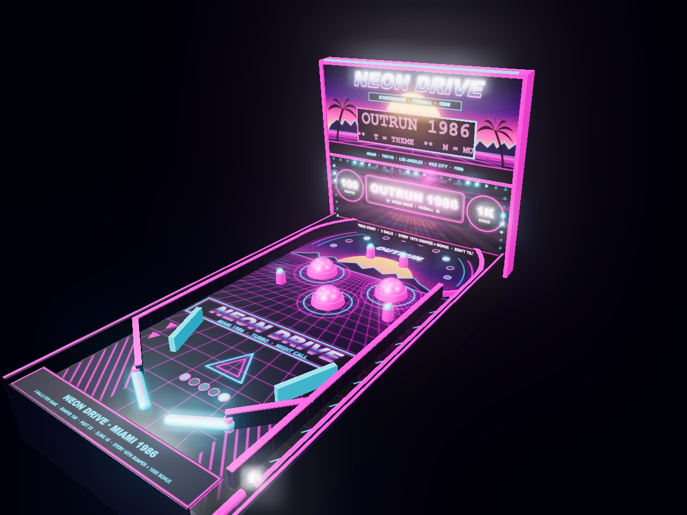
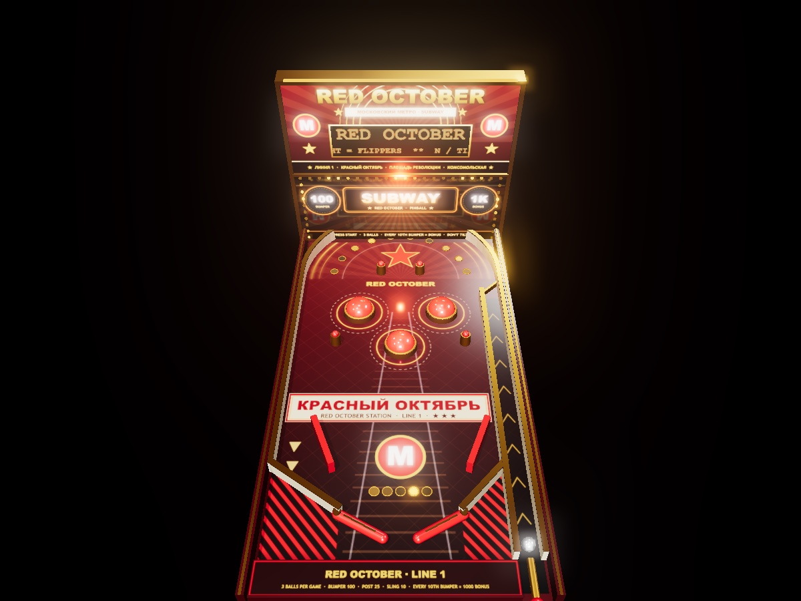
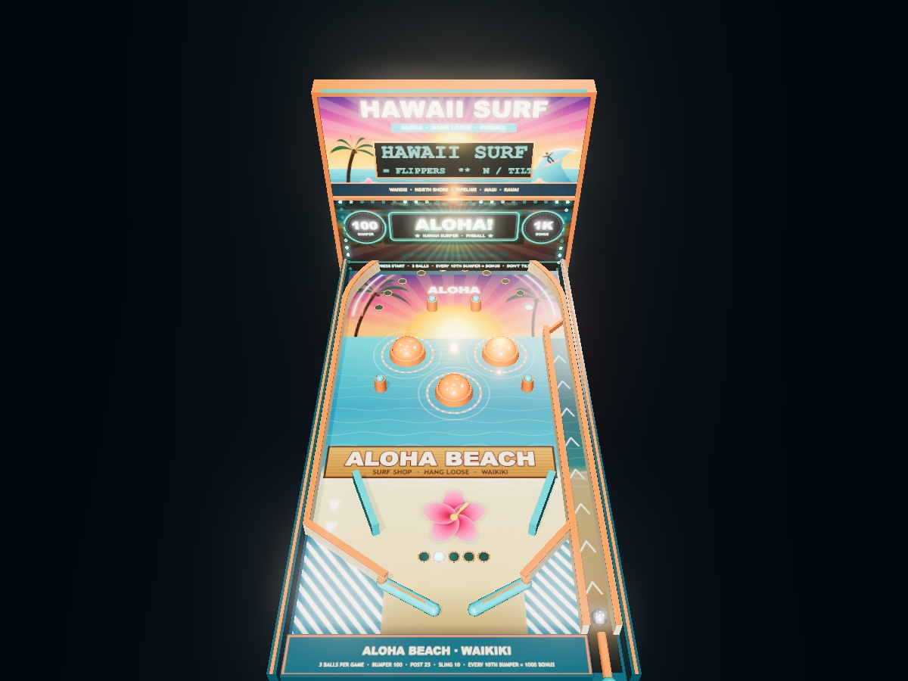
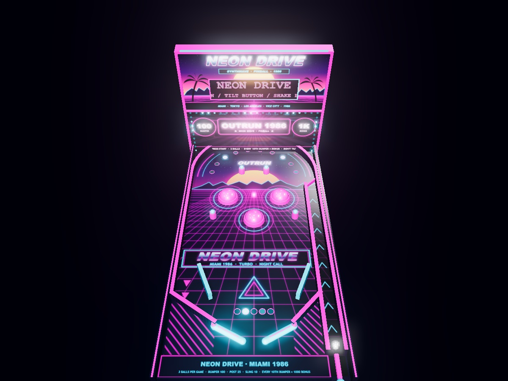
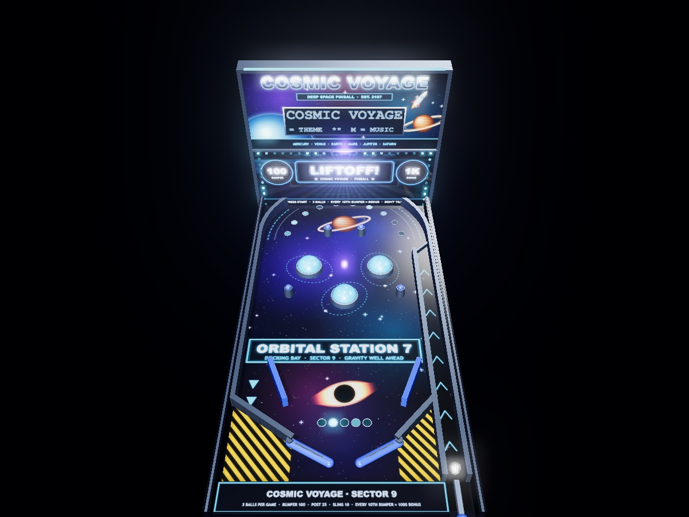
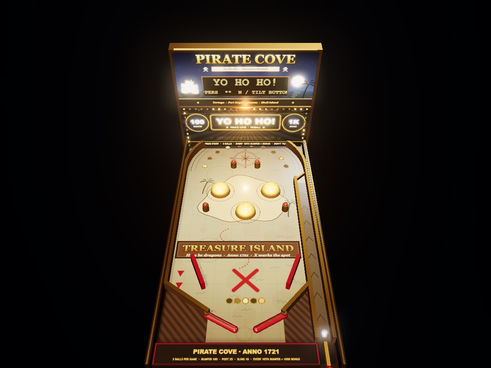
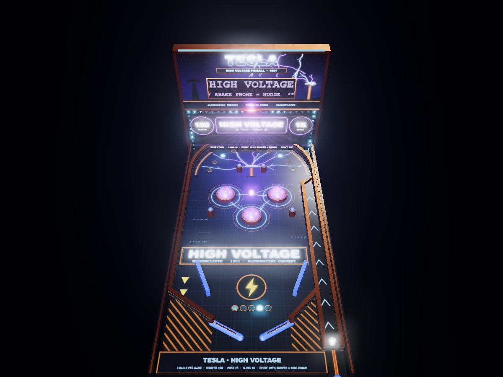
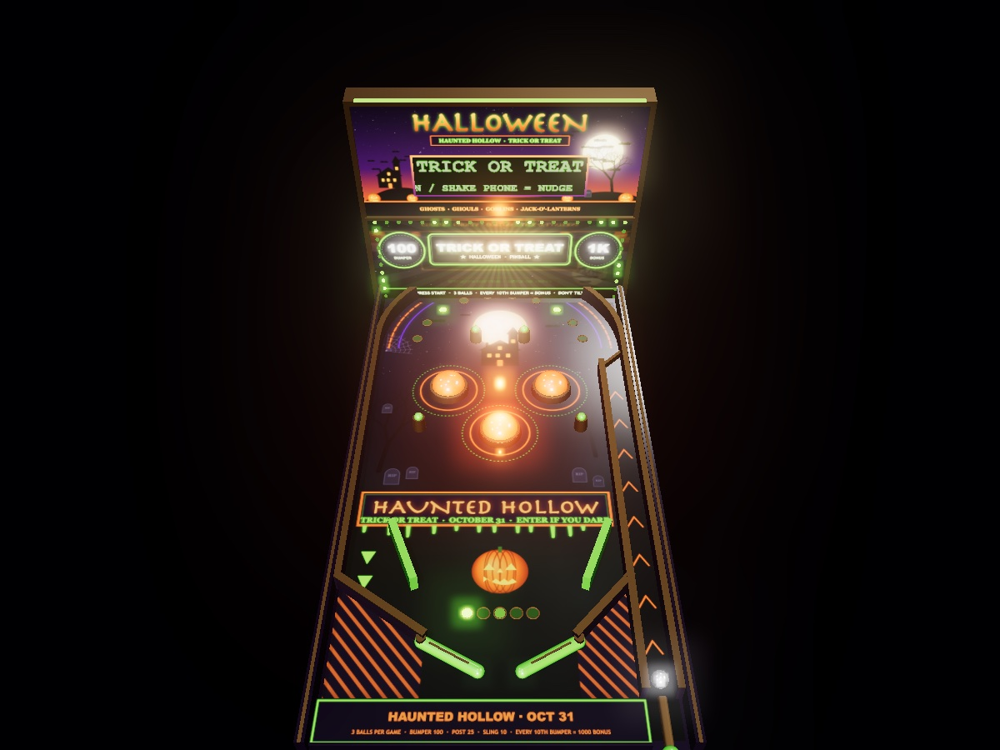
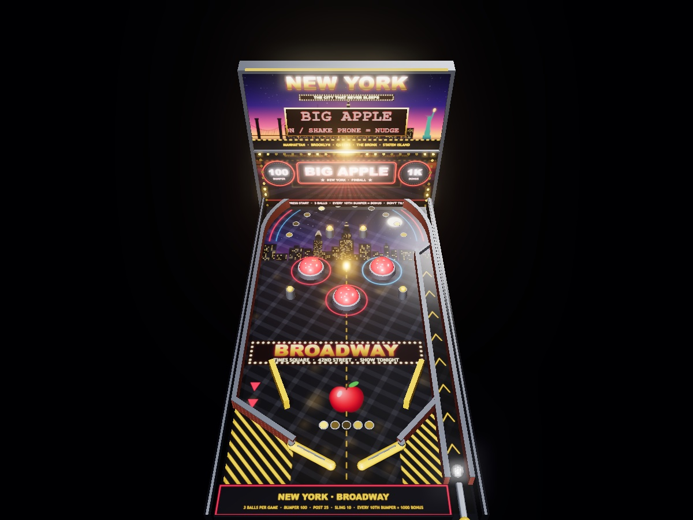

# 3D Pinball – Theme Edition

Browser pinball game in vanilla JavaScript with three.js and WebAudio (no build step).

**▶ Play online: https://helmutqualtinger.github.io/flipper/**



## Screenshots

| Red October | Hawaii Surfer | Neon Drive |
|---|---|---|
|  |  |  |

| Cosmic Voyage | Pirate Cove | Tesla |
|---|---|---|
|  |  |  |

| Halloween | Safari | New York |
|---|---|---|
|  |  |  |

## Features

- 3D table with custom ball physics (flippers, bumpers, slingshots, posts, plunger, one-way gate)
- Tall backbox with dot-matrix score display and chase lights
- Nine themes with their own artwork, colours and music: Red October, Hawaii Surfer, Neon Drive, Cosmic Voyage, Pirate Cove, Tesla, Halloween, Safari, New York
- Bloom glow, insert lamps, particles, score popups, ball trail
- Free camera: drag to rotate, wheel or pinch to zoom
- Synthesized sound effects and music
- Theme popup menu, TILT button with real tilt penalty, shake-to-nudge on phones
- Installable web app (PWA) with offline support; social media preview card

## Run

ES modules require HTTP (not `file://`):

```sh
python3 -m http.server 8765
```

Then open http://localhost:8765/

## Controls

| Action | Keys |
|---|---|
| Left / right flipper | ← / → (also Z, ., Shift) |
| Launch | hold Space, release |
| Nudge | N |
| Next theme | T |
| Music on/off | M |
| Bloom on/off | B |
| Reset view | R or double-click |

## Structure

| File | Content |
|---|---|
| `main.js` | Scene, physics, game logic, effects, render loop |
| `sound.js` | Sound effects and music |
| `layout.js` | Shared table geometry |
| `art.js` | Canvas drawing helpers |
| `themes/` | One module per theme |
| `lib/` | three.js r160 (vendored) |
